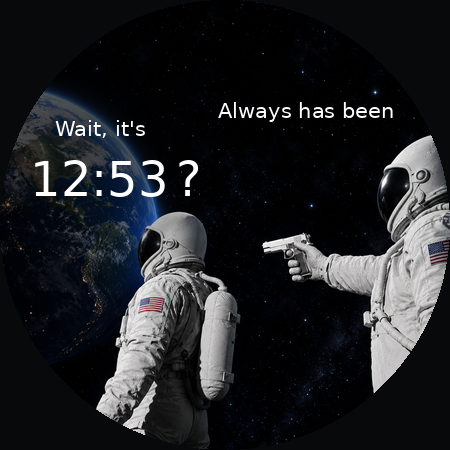

# Always Has Been — Wear OS Watch Face

A watch face inspired by the astronaut meme, with a live clock built into the joke.



**Want to use it?** Install `AlwaysHasBeen.apk`. You do **not** need Android Studio or Gradle.

**Want to customize it?** Clone the repository, edit the Watch Face Format XML, and build your own APK.

## Features

- Live time that follows the watch's 12/24-hour setting.
- "Wait, it's …?" and "Always has been" captions.
- Dimmed Earth for better time readability.
- Minimal always-on display: dim time on a black background.
- Resource-only Watch Face Format project; no Kotlin or Java rendering service.

Version **1.1** moves the left caption and clock down and adds a dark gradient over Earth. This version does **not** include complications yet.

## Compatibility

- Wear OS 4 or newer, with Android API 33 or newer.
- Tested on a Samsung Galaxy Watch 8. Other compatible watches have not been verified.
- Not compatible with older Tizen Galaxy Watches or Apple Watch.
- The phone installation method below requires an Android phone.

## Download

Download **`AlwaysHasBeen.apk`** from this repository, or from the [download folder](https://drive.google.com/drive/folders/10v6hZZIUB6VPYFb7AMI8F_hfNrHyyzqQ?usp=sharing).

The included APK is already built. Opening it as a normal phone app does not install it on the watch.

## Install from an Android phone

1. Download `AlwaysHasBeen.apk` to your phone.
2. Install [GeminiMan WearOS Manager](https://play.google.com/store/apps/details?id=com.geminiman.wearosmanager) on your phone.
3. Connect your phone and watch to the same Wi-Fi network.
4. On a Galaxy Watch, open **Settings → About watch → Software information** and tap **Software version five times** to enable developer options. Menu names may differ on other watches.
5. Open **Settings → Developer options** and enable **ADB debugging** and **Wireless debugging**.
6. Open **Wireless debugging → Pair new device**. In GeminiMan, pair using the IP address, pairing port, and pairing code displayed on the watch.
7. Return to the watch's main **Wireless debugging** screen. Connect in GeminiMan using the IP address and connection port displayed there.
8. In GeminiMan, select **Install APK**, choose `AlwaysHasBeen.apk`, and wait for installation to finish.
9. On the watch, long-press the current watch face, choose **Add watch face**, and select **Always Has Been**.
10. Turn off ADB debugging and Wireless debugging when finished. The face will keep working.

**Important:** The pairing port and connection port are different. Use the pairing screen for pairing and the main Wireless debugging screen for connecting.

## Install from a computer

Install [Android SDK Platform Tools](https://developer.android.com/tools/releases/platform-tools). Put the APK in your `platform-tools` folder and open a terminal there.

Connect the watch and computer to the same Wi-Fi, then enable debugging on the watch as described above.

Run these commands, replacing the uppercase placeholders with the values shown on your watch:

```sh
adb pair WATCH_IP:PAIRING_PORT
```

Enter the pairing code when prompted. Return to the main Wireless debugging screen and use its connection port:

```sh
adb connect WATCH_IP:CONNECTION_PORT
adb install -r AlwaysHasBeen.apk
```

In **Windows PowerShell**, use `.\adb` instead of `adb` when running from the platform-tools folder:

```powershell
.\adb pair WATCH_IP:PAIRING_PORT
.\adb connect WATCH_IP:CONNECTION_PORT
.\adb install -r .\AlwaysHasBeen.apk
```

Select the watch face on the watch, then turn off debugging. See [Google's Wi-Fi debugging guide](https://developer.android.com/training/wearables/get-started/debug-wifi) for connection troubleshooting.

## Build your own version

### Requirements

| Component | Project version |
| --- | --- |
| JDK | 17 |
| Android Gradle Plugin | 8.9.2 |
| Gradle | 8.11.1, supplied through the wrapper |
| Compile SDK / target SDK | 35 |
| Minimum SDK | 33 |
| Watch Face Format | 1 |

The first build downloads Gradle and dependencies, so an internet connection is required. No separate Gradle installation is needed.

### Android Studio

1. Clone the repository or download and extract its ZIP.
2. In [Android Studio](https://developer.android.com/studio), choose **Open** and select the folder containing `settings.gradle.kts`.
3. Use JDK 17 as the Gradle JDK. Install Android SDK Platform 35 and any required SDK components when prompted.
4. Let Gradle sync finish.
5. Open Android Studio's terminal and run the build command below.

### Command line

Clone into a known folder, replacing `REPOSITORY_URL` with this repository's GitHub URL:

```sh
git clone REPOSITORY_URL always-has-been
cd always-has-been
```

Make sure JDK 17 is available and the Android SDK is configured through Android Studio, `ANDROID_HOME`, or an untracked `local.properties` file containing `sdk.dir`.

**Windows PowerShell:**

```powershell
.\gradlew.bat assembleDebug
```

**macOS / Linux:**

```sh
chmod +x gradlew
./gradlew assembleDebug
```

The built APK is:

```text
app/build/outputs/apk/debug/app-debug.apk
```

With ADB connected to your watch, install it from the project root:

```sh
adb install -r app/build/outputs/apk/debug/app-debug.apk
```

Windows PowerShell example, with platform-tools available on your PATH:

```powershell
adb install -r .\app\build\outputs\apk\debug\app-debug.apk
```

### Signing and updates

The included APK and your local build may use different signing keys. Android only allows an update when the package name and signing identity match.

If installation reports `INSTALL_FAILED_UPDATE_INCOMPATIBLE`, switch to another watch face, uninstall the existing version, and then install your build:

```sh
adb uninstall se.johanhammer.alwayshasbeen
adb install app/build/outputs/apk/debug/app-debug.apk
```

Uninstalling removes that watch face's saved settings. Alternatively, give your fork a different `applicationId` to install it alongside the original.

The supplied APK uses a development certificate. Publishing requires a properly configured release build and signing setup.

## Customize the face

| File | What to change |
| --- | --- |
| `app/src/main/res/raw/watchface.xml` | Layout, captions, clock, dimming, ambient mode, and complications |
| `app/src/main/res/drawable-nodpi/background.png` | Background artwork |
| `app/src/main/res/drawable-nodpi/preview.png` | Watch face picker preview |
| `preview.png` | Repository preview image |
| `app/src/main/res/font/meme.ttf` | Font; see `FONT-LICENSE.txt` |
| `app/src/main/res/xml/watch_face_info.xml` | Picker metadata and whether the face is editable |
| `app/src/main/AndroidManifest.xml` | Watch requirements, label, and WFF declaration |
| `app/build.gradle.kts` | SDK levels, application ID, and version |

The layout uses a **450 × 450** canvas. Edit element coordinates and dimensions in `watchface.xml`; Wear OS scales the layout to the display. Keep text inside the circular screen and check the result on the watch.

The dark gradient over Earth is a `PartDraw` element, so its strength and position can be adjusted without editing the image.

## Add complications: steps, battery, weather, etc.

Complications are the small data fields on a watch face. This project currently has none, but you can add them in `watchface.xml`.

Use Wear OS complication data sources rather than adding a custom sensor-reading service to this resource-only face.

1. Add a `ComplicationSlot` to the `Scene`, with a unique slot ID, bounds, and supported data types.
2. Start with `SHORT_TEXT` for a compact text field. Only advertise types that your layout actually renders.
3. Render the supplied text inside the slot using `COMPLICATION.TEXT`, following Google's example.
4. For steps, a default provider can be set to `STEP_COUNT` with type `SHORT_TEXT`. Provider availability depends on the watch.
5. Set `<Editable value="true" />` in `watch_face_info.xml` if users should be able to select their own complication providers.
6. Decide how the field should look in ambient mode. Test empty data, long values, and different providers.

Follow the [official WFF complications guide](https://developer.android.com/training/wearables/wff/complications) and the [WFF setup guide](https://developer.android.com/training/wearables/wff/setup). Check that elements you add are supported by **WFF version 1**; newer examples may use features that need a newer format and Wear OS version.

Adding a slot alone does not draw its data. You must also define how each supported complication type is displayed.

## Troubleshooting

| Problem | What to try |
| --- | --- |
| Paired, but cannot connect | Use the connection port from the main Wireless debugging screen, not the pairing port. |
| Connection refused or times out | Check both devices are on the same Wi-Fi; recheck the current IP and port. Guest Wi-Fi may block communication between devices. |
| APK will not install on the phone | Expected: it is a watch APK. Install through GeminiMan or ADB. |
| Signature mismatch | See **Signing and updates** above. |
| Face not visible after installation | Look under **Add watch face** on the watch itself; restart the watch if necessary. |
| Gradle cannot find the SDK | Open the project in Android Studio and configure the SDK location. |
| Steps/weather field is blank in a fork | Select a compatible installed provider and handle empty complication data. |

## Contributing

Layout improvements, complications, and compatibility fixes are welcome as pull requests. Include a screenshot, the watch model/Wear OS version tested, and a short description of the change. Check both normal and always-on modes.

Never commit signing keys, passwords, `local.properties`, or build caches. The included `.gitignore` covers the common local files.

## Artwork and licensing

The background is newly generated artwork inspired by the meme. Commercial rights to the original meme artwork have not been established; this repository does not claim ownership of that original artwork or grant rights to it. The bundled font has its own license in `FONT-LICENSE.txt`. No project-wide open-source license has been selected yet.
